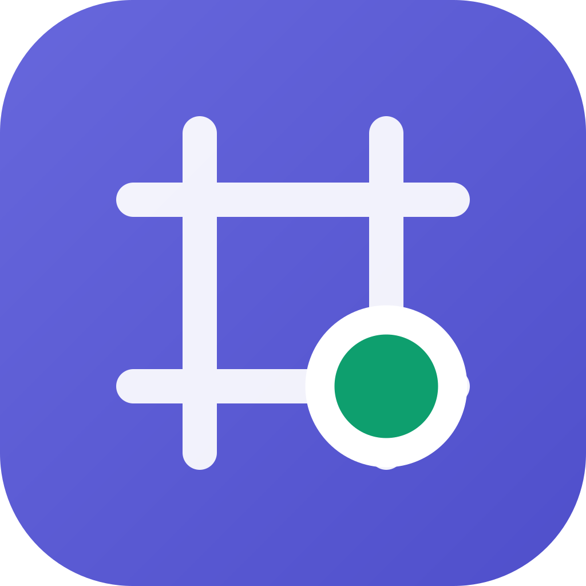
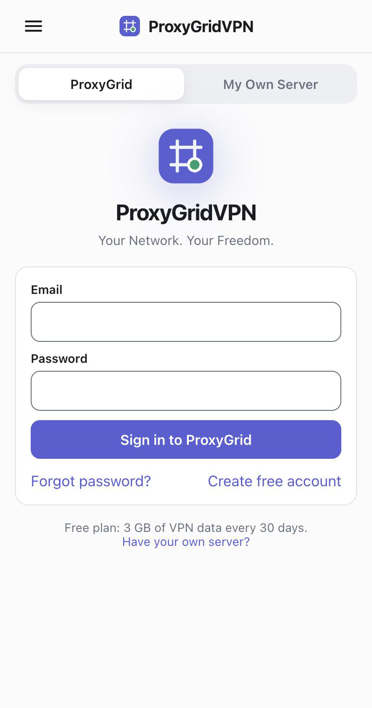
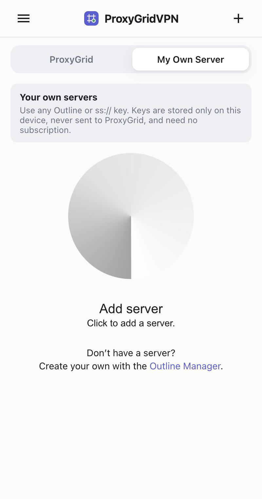

<p align="center">
  
</p>

<h1 align="center">ProxyGridVPN client</h1>

<p align="center">
  The open-source VPN client for <a href="https://proxygrid.net">ProxyGrid</a>, and for any
  Outline-compatible server you run yourself.
</p>

<p align="center">
  <a href="LICENSE"></a>
  <a href="https://github.com/proxygridx/proxygridvpn-client/actions/workflows/proxygridvpn_builds.yml"></a>
</p>

ProxyGridVPN is a cross-platform VPN client. Its source code is public so anyone can inspect it,
review its security and contribute. The ProxyGrid hosted VPN service (accounts, API, billing and
servers) is operated privately and is **not** part of this repository.

<p align="center">
  
  &nbsp;
  
</p>

## Features

- **ProxyGrid account mode.** Sign in with your proxygrid.net account, pick a location and
  connect. The app fetches your access key for you and shows how much data is left in your plan.
- **My own servers mode.** Add `ss://` or `ssconf://` access keys for any Outline-compatible
  Shadowsocks server. These keys never go to ProxyGrid and have no ProxyGrid limits.
- **Keys in the OS keychain.** Access keys are stored with Apple Keychain, the Android Keystore or
  Electron safeStorage.
- **Installs beside Outline.** Separate app IDs, URL scheme (`proxygridvpn://`), Windows service
  and network adapter names, so it does not conflict with the official Outline app.
- **Stability fixes** over the upstream client: DNS burst handling without sharing UDP
  associations (RFC 5452 kept), network-change and wake handling, tunnel start/stop races and
  packet-relay robustness. See [docs/proxygridvpn/STABILITY.md](docs/proxygridvpn/STABILITY.md).

## Install on Windows

Download the [Windows 10/11 beta](https://github.com/proxygridx/proxygridvpn-client/releases/tag/proxygridvpn-v1.0.0-beta.1).
Choose the `ia32.exe` installer for Intel or AMD PCs (including 64-bit), or `arm64.exe` for
Windows on ARM. Both are **unsigned**: [verify the download](docs/windows.md#verify-a-download)
before running it. Beta 1 works with your own server key; ProxyGrid account sign-in is not
configured in these installers.

## Platforms

| Platform | Minimum OS | Status |
|---|---|---|
| macOS | 12.4 | Builds and signs (development); device testing in progress |
| Windows | 10 / 11 | Public beta; [install and uninstall](docs/windows.md) |
| Android | 10 | Debug builds in CI; device testing in progress |
| iOS | 15.5 | Builds and signs (development); device testing in progress |
| Linux (Debian-based) | — | Builds from source; not tested |

## How it connects

- **ProxyGrid account (optional).** Sign-in uses Amazon Cognito; the app then calls
  `api.proxygrid.net` for your plan, usage and a per-region access key. The key is an Outline
  dynamic key (`ssconf://api.proxygrid.net/vpn/c/...`), so the VPN connection itself uses the
  same Shadowsocks code as any other server. ProxyGrid's servers and backend are operated
  privately and are not part of this repository or of any signed download.
- **Your own servers.** Paste an `ss://` or `ssconf://` key from any Outline-compatible
  Shadowsocks server. These keys stay on your device and are never sent to ProxyGrid.

See the [privacy policy](PRIVACY.md) for every connection the app makes.

## Building

You need [Node.js](https://nodejs.org/) 22 and [Go](https://go.dev/) (version in `go.mod`), plus
the per-platform tools (Xcode for Apple platforms, Android Studio / JDK 17 for Android, Visual
Studio build tools for the Windows helpers).

```sh
npm ci
npm run action client/web/start          # the shared UI in a browser, with fake servers
npm run action client/web/test           # web unit tests
go test -race ./client/go/...            # Go core tests
npm run action client/electron/build windows -- --arch ia32
npm run action client/src/cordova/build android
npm run action client/src/cordova/setup macos   # then open client/src/cordova/apple/client.xcworkspace
```

ProxyGrid account sign-in is enabled at build time with the public sign-in identifiers in
`PROXYGRID_COGNITO_REGION`, `PROXYGRID_USER_POOL_ID` and `PROXYGRID_USER_POOL_CLIENT_ID`. Without
them the app runs in own-server mode only. To sign and distribute your own builds, use your own
signing identities and app IDs. More detail: [client/README.md](client/README.md) and
[docs/life_of_a_packet.md](docs/life_of_a_packet.md).

## Code signing policy

Windows releases are intended to be signed through the SignPath Foundation program.
The current Windows beta is unsigned. Roles, approvals and what will be signed:
[CODE_SIGNING_POLICY.md](CODE_SIGNING_POLICY.md).

Once signing is active, signed releases will carry this attribution: free code signing provided
by [SignPath.io](https://about.signpath.io), certificate by
[SignPath Foundation](https://signpath.org).

## Contributing

Contributions are welcome. Read [CONTRIBUTING.md](CONTRIBUTING.md) and the
[code of conduct](CODE_OF_CONDUCT.md) first: changes need tests and must pass CI. Open an issue to discuss larger changes before starting.

## Security

Please report vulnerabilities privately as described in [SECURITY.md](SECURITY.md). Do not open
public issues for security problems.

## Privacy

ProxyGridVPN collects no analytics. See the [privacy policy](PRIVACY.md).

## License and acknowledgements

ProxyGridVPN is licensed under the [Apache License 2.0](LICENSE). See [NOTICE](NOTICE).

ProxyGridVPN is independently developed by ProxyGrid from the open-source
[Outline client](https://github.com/OutlineFoundation/outline-apps) by The Outline Authors and is
powered by [Shadowsocks](https://shadowsocks.org/). It is not affiliated with or endorsed by the
Outline Foundation, Jigsaw or Google. Third-party licenses are listed in the app under
About > Licenses.

---

[proxygrid.net](https://proxygrid.net)
